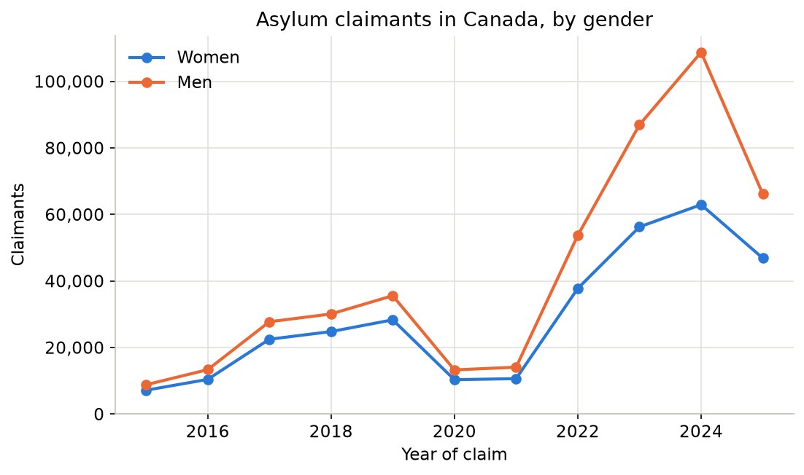
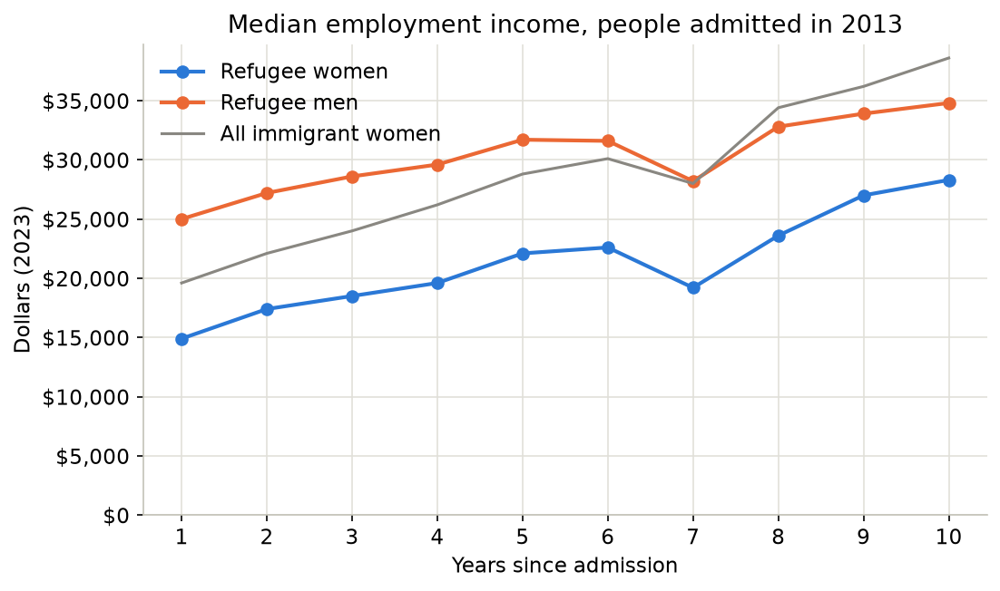
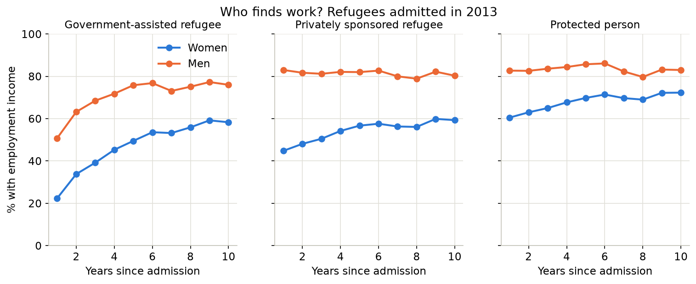
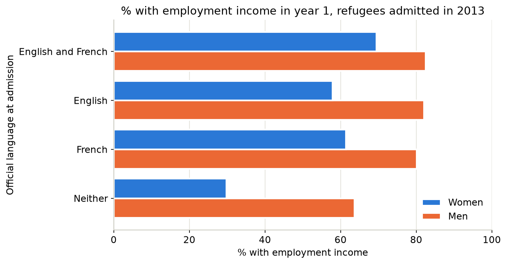

# Refugee Women in Canada: Closing the Work and Income Gap

*A beginner-to-intermediate project in data collection, analysis and visualization with Python.*

---

## The problem

Canada takes in tens of thousands of refugees and asylum claimants every year, and about 4 in 10 asylum claimants are women. Work and income are key **social determinants of health**: they shape housing, food security, stress and access to care.

Refugee women often face extra barriers, such as language, childcare, interrupted schooling and trauma. **But how big is the gap, and does it close?**

**Your question:** How far behind are refugee women in work and income? Does the gap close over 10 years? Which refugee women need support most?

**Your deliverable:** a one-page evidence brief (`findings.md`) with 4 charts and 3–5 key numbers. Write it for a settlement agency deciding where to focus a new employment program for women.

---

## What you'll learn

| Step | Skill | Python tools |
|---|---|---|
| 1 | Collect and document public data | browser, Terminal |
| 2 | Load and inspect data | `read_csv`, `shape`, `head`, `unique` |
| 3 | Clean messy real-world data | `dropna`, `replace`, `to_numeric`, `isin` |
| 4 | Summarize | `groupby`, `unstack`, new columns |
| 5 | Filter, reshape and reuse code | `pivot`, writing a function |
| 6 | Visualize | matplotlib: line charts, small multiples, bar charts |
| 7 | Compare groups and measure gaps | ratios, percentage points, `idxmin` |
| 8 | Communicate results | `to_csv`, writing files, f-strings |

---

## Before you start

- A Mac with **Terminal** (press `⌘ + Space`, type *Terminal*, press Enter).
- **Python 3.9 or newer.** Check with `python3 --version`. If a pop-up asks to install *command line developer tools*, click **Install**. Or install Python from [python.org](https://www.python.org/downloads/).
- A code editor such as VS Code, or IDLE (comes with Python from python.org). Don't use TextEdit: it changes quotes and breaks code.
- Basic Python: variables, lists, dictionaries, `for` loops, functions, f-strings.
- Time: about 4–6 hours.

No accounts, API keys or web programming are needed. You download two files and work with them on your computer.

---

## Key terms

| Term | Meaning |
|---|---|
| **Government-assisted refugee (GAR)** | Resettled from abroad. The Government of Canada gives income support and settlement help, usually for the first year. |
| **Privately sponsored refugee (PSR)** | Resettled from abroad. A private group, such as a faith or community group, supports them, usually for the first year. |
| **Protected person** | Claimed asylum *inside* Canada and was accepted as a refugee. |
| **Admission year** | The year a person became a permanent resident. |
| **Cohort** | A group admitted in the same year that we follow over time (for example, the 2013 cohort). |
| **Median employment income** | The middle income among people who had employment income. People with $0 are not included. |
| **Incidence of employment income** | The % of tax filers who had *any* employment income that year. |

---

## Setup (once)

Copy these lines into Terminal one at a time:

```bash
cd ~
mkdir -p refugee-women-project/data/raw refugee-women-project/outputs
cd refugee-women-project
python3 -m venv .venv
source .venv/bin/activate
pip install pandas matplotlib
```

You should now see `(.venv)` at the start of the Terminal line. **Every time you open a new Terminal window**, run:

```bash
cd ~/refugee-women-project
source .venv/bin/activate
```

---

## Step 1: Collect the data

Click each link to download the file. No account is needed.

| # | Dataset | Publisher | Download |
|---|---|---|---|
| 1 | Income of immigrant tax filers by admission category, table 43-10-0026-01 (Canada; women and men; 8 admission categories; tax years 2009–2023) | Statistics Canada | [CSV, 15 MB](https://www150.statcan.gc.ca/t1/tbl1/en/dtl!downloadDbLoadingData-nonTraduit.action?pid=4310002601&latestN=&startDate=20090101&endDate=20230101&csvLocale=en&selectedMembers=%5B%5B1%5D%2C%5B2%2C3%5D%2C%5B1%5D%2C%5B1%2C2%2C3%2C4%2C5%5D%2C%5B1%2C2%2C3%2C4%2C5%2C6%2C7%2C8%2C9%2C10%2C11%2C12%2C13%2C14%2C15%5D%2C%5B1%2C3%2C6%2C12%2C18%2C19%2C20%2C22%5D%2C%5B1%2C3%2C6%2C11%5D%5D&checkedLevels=) |
| 2 | Asylum claimants by province, gender and month (2015 to the latest month) | Immigration, Refugees and Citizenship Canada (IRCC) | [CSV, 0.2 MB](https://www.ircc.canada.ca/opendata-donneesouvertes/data/ODP-Asylum-PT_Gender.csv) |

> **Safari tip:** if a file opens in a tab instead of downloading, right-click the link and choose **Download Linked File**.

Move the files into your project and give them short names:

```bash
mv ~/Downloads/4310002601_databaseLoadingData.csv data/raw/statcan_income.csv
mv ~/Downloads/ODP-Asylum-PT_Gender.csv data/raw/ircc_asylum_claims.csv
ls -lh data/raw
```

You should see two files, about 15 MB and 180 KB.

> **Backup:** if a link stops working, download the same files from this repository's [`data/raw/`](data/raw/) folder. They were downloaded on 25 November 2026.

**Your turn:** real analysts always record where their data came from. Create `data/SOURCES.md`. For each file, write the title, publisher, link, download date and licence (see [Data sources and licences](#data-sources-and-licences)).

---

## How Steps 2–8 work

You build **one script**, `refugee_women.py`, in the project folder:

1. Add each step's code **to the end** of the script.
2. Save, then run the whole script:

   ```bash
   python3 refugee_women.py
   ```

3. Compare your output with the **Checkpoint**. Lines with `...` are skipped output.

Earlier steps run again each time. That's fine, and it only takes a few seconds.

From Step 5 on, the code has blanks (`___`) for you to fill in. Use the hints. If you're stuck, open **Show solution**.

> If your numbers differ a little from the checkpoints, the publisher has probably updated the data since 25 November 2026. That's normal.

---

## Step 2: Load and inspect

**Goal:** open both files and see what's inside.

```python
# refugee_women.py
# Refugee women in Canada: work and income gaps (a step-by-step data project)

import pandas as pd
import matplotlib.pyplot as plt

pd.set_option("display.width", 120)
pd.set_option("display.max_columns", 12)

# ---------------------------------------------------------------
# STEP 2: Load and inspect
# ---------------------------------------------------------------
print("\n=== STEP 2: Load and inspect ===")

income = pd.read_csv("data/raw/statcan_income.csv")
asylum = pd.read_csv("data/raw/ircc_asylum_claims.csv", sep="\t")  # tabs, not commas!

print("Income table (rows, columns):", income.shape)
print(income.columns.tolist())
print(income[["REF_DATE", "Sex", "Admission year", "Statistics", "VALUE"]].head())
print(income["Statistics"].unique().tolist())
print(income["Immigrant admission category"].unique().tolist())

print("\nAsylum table (rows, columns):", asylum.shape)
print(asylum.head())
```

**Checkpoint**

```text
=== STEP 2: Load and inspect ===
Income table (rows, columns): (57588, 20)
...
['Total number of residents', 'Median employment income', 'Incidence of employment income', 'Incidence of social assistance']
...
Asylum table (rows, columns): (2645, 11)
```

**Your turn:** delete `, sep="\t"` and run again. How many columns does the asylum table have now, and why? Then put it back. (The file ends in `.csv`, but its values are separated by tabs.)

---

## Step 3: Clean

**Goal:** keep only the columns you need, give them short names, and fix empty or hidden values.

```python
# ---------------------------------------------------------------
# STEP 3: Clean
# ---------------------------------------------------------------
print("\n=== STEP 3: Clean ===")

# 3a. Income: keep 7 columns and give them short names
income = income[["REF_DATE", "Sex", "Knowledge of official languages at admission",
                 "Admission year", "Immigrant admission category", "Statistics", "VALUE"]]
income.columns = ["tax_year", "sex", "language", "admission_year",
                  "category", "statistic", "value"]

# Empty values ("..") are tax years up to the admission year: no income data yet
print("Empty income values:", income["value"].isna().sum())
income = income.dropna(subset=["value"])

# "2013, admission year" -> 2013 (text -> number)
income["admission_year"] = income["admission_year"].str[:4].astype(int)

# Shorter labels
income["sex"] = income["sex"].replace({"Females": "Women", "Males": "Men"})
income["language"] = income["language"].replace({
    "Total, knowledge of official languages": "All",
    "Neither English nor French": "Neither",
})
income["category"] = income["category"].replace({
    "Total, immigrant admission category": "All immigrants",
    "Refugee": "All refugees",
    "Protected person in Canada": "Protected person",
    "Economic Immigrant, principal applicant": "Economic, principal applicant",
    "Economic Immigrant, spouse and dependent": "Economic, spouse or dependant",
})

# 3b. Asylum: keep 5 columns and give them short names
asylum = asylum[["EN_YEAR", "EN_MONTH", "EN_PROVINCE_TERRITORY", "EN_GENDER", "TOTAL"]]
asylum.columns = ["year", "month", "province", "gender", "claimants"]

# "--" hides small counts (between 0 and 5) for privacy. "--" -> empty -> 0
print('Hidden asylum counts ("--"):', (asylum["claimants"] == "--").sum())
asylum["claimants"] = pd.to_numeric(asylum["claimants"], errors="coerce").fillna(0).astype(int)

# Keep women and men (the other gender groups are very small and mostly hidden)
asylum["gender"] = asylum["gender"].replace({"Female": "Women", "Male": "Men"})
asylum = asylum[asylum["gender"].isin(["Women", "Men"])]

print("Rows left -> income:", len(income), "| asylum:", len(asylum))
print(income.head())
```

**Checkpoint**

```text
=== STEP 3: Clean ===
Empty income values: 24000
Hidden asylum counts ("--"): 909
Rows left -> income: 33588 | asylum: 2416
```

**Think about it:** we replaced every `--` with 0, but each one really stands for a few people. If you used 2 instead, how much would the totals change? (Compare 909 × 2 with the yearly totals in Step 4.)

---

## Step 4: Who is claiming asylum?

**Goal:** count claimants per year by gender, and work out the share who are women.

```python
# ---------------------------------------------------------------
# STEP 4: Who is claiming asylum?
# ---------------------------------------------------------------
print("\n=== STEP 4: Who is claiming asylum? ===")

# One row per year, one column per gender
by_year = asylum.groupby(["year", "gender"])["claimants"].sum().unstack()

# Keep only complete years (12 months of data)
months = asylum.groupby("year")["month"].nunique()
by_year = by_year[months == 12]

by_year["women_pct"] = (by_year["Women"] / (by_year["Women"] + by_year["Men"]) * 100).round(1)
print(by_year)

latest = by_year.index.max()
print(f"In {latest}, {by_year.loc[latest, 'Women']:,} women claimed asylum in Canada "
      f"({by_year.loc[latest, 'women_pct']}% of all claimants).")
```

**Checkpoint**

```text
gender     Men  Women  women_pct
year
2015      8785   7140       44.8
...
2024    108745  62920       36.7
2025     66110  46835       41.5
In 2025, 46,835 women claimed asylum in Canada (41.5% of all claimants).
```

**Think about it:** why did claims drop in 2020–2021? Is the share of women rising or falling?

---

## Step 5: Follow one group for 10 years

**Goal:** follow everyone admitted in 2013 (the *cohort*) through 10 tax years. You'll write a function you can reuse in later steps.

```python
# ---------------------------------------------------------------
# STEP 5: Follow one group of newcomers for 10 years
# ---------------------------------------------------------------
print("\n=== STEP 5: Follow one group for 10 years ===")

income["years_since_admission"] = income["___"] - income["___"]

COHORT = 2013  # people who became permanent residents in 2013


def get_table(statistic, category, language="All"):
    """One row per year since admission, one column per sex (Men, Women)."""
    rows = income[(income["admission_year"] == COHORT)
                  & (income["statistic"] == statistic)
                  & (income["category"] == ___)
                  & (income["language"] == language)]
    return rows.pivot(index="years_since_admission", columns="sex", values="value")


pay = get_table("Median employment income", "All refugees")
work = get_table("___", "All refugees")

print(f"Median employment income ($), refugees admitted in {COHORT}:")
print(pay)
print(f"\n% with any employment income, refugees admitted in {COHORT}:")
print(work)
```

**Hints**
- Years since admission = tax year − admission year.
- Inside a function, compare with the function's *parameter*, not a fixed text.
- The exact statistic names were printed in Step 2.

<details>
<summary>Show solution</summary>

```python
# ---------------------------------------------------------------
# STEP 5: Follow one group of newcomers for 10 years
# ---------------------------------------------------------------
print("\n=== STEP 5: Follow one group for 10 years ===")

income["years_since_admission"] = income["tax_year"] - income["admission_year"]

COHORT = 2013  # people who became permanent residents in 2013


def get_table(statistic, category, language="All"):
    """One row per year since admission, one column per sex (Men, Women)."""
    rows = income[(income["admission_year"] == COHORT)
                  & (income["statistic"] == statistic)
                  & (income["category"] == category)
                  & (income["language"] == language)]
    return rows.pivot(index="years_since_admission", columns="sex", values="value")


pay = get_table("Median employment income", "All refugees")
work = get_table("Incidence of employment income", "All refugees")

print(f"Median employment income ($), refugees admitted in {COHORT}:")
print(pay)
print(f"\n% with any employment income, refugees admitted in {COHORT}:")
print(work)
```

</details>

**Checkpoint**

```text
Median employment income ($), refugees admitted in 2013:
sex                        Men    Women
years_since_admission
1                      25000.0  14900.0
2                      27200.0  17400.0
...
10                     34800.0  28300.0
```

**Think about it:** look at year 7 in both tables. Which tax year is that for the 2013 cohort, and what happened that year?

---

## Step 6: Charts

**Goal:** make 4 charts that answer the question. Women are always blue and men always orange, so readers never have to re-learn the colours.

### 6a. Style and Chart 1 (full code, use it as your model)

```python
# ---------------------------------------------------------------
# STEP 6: Charts
# ---------------------------------------------------------------
print("\n=== STEP 6: Charts ===")

WOMEN, MEN, GREY = "#2a78d6", "#eb6834", "#898781"  # same colours in every chart
plt.rcParams.update({
    "axes.spines.top": False,
    "axes.spines.right": False,
    "axes.edgecolor": "#c3c2b7",
    "axes.grid": True,
    "axes.axisbelow": True,
    "grid.color": "#e1e0d9",
    "lines.linewidth": 2,
    "font.size": 11,
    "savefig.dpi": 150,
    "savefig.bbox": "tight",
})

# Chart 1: asylum claimants per year, by gender
fig, ax = plt.subplots(figsize=(8, 4.5))
ax.plot(by_year.index, by_year["Women"], color=WOMEN, marker="o", label="Women")
ax.plot(by_year.index, by_year["Men"], color=MEN, marker="o", label="Men")
ax.set_title("Asylum claimants in Canada, by gender")
ax.set_xlabel("Year of claim")
ax.set_ylabel("Claimants")
ax.set_ylim(bottom=0)
ax.yaxis.set_major_formatter("{x:,.0f}")
ax.legend(frameon=False)
fig.savefig("outputs/1_asylum_claimants.png")
plt.close(fig)
```

### 6b. Chart 2: the income gap over time

```python
# Chart 2: income over time, refugee women vs refugee men (+ all immigrant women)
all_pay = get_table("Median employment income", "All immigrants")
fig, ax = plt.subplots(figsize=(8, 4.5))
ax.plot(pay.index, pay["___"], color=WOMEN, marker="o", label="Refugee women")
ax.plot(pay.index, pay["Men"], color=___, marker="o", label="Refugee men")
ax.plot(all_pay.index, all_pay["Women"], color=GREY, linewidth=1.5, label="All immigrant women")
ax.set_title(f"Median employment income, people admitted in {COHORT}")
ax.set_xlabel("Years since admission")
ax.set_xticks(pay.index)
ax.set_ylabel("Dollars (2023)")
ax.set_ylim(bottom=0)
ax.yaxis.set_major_formatter("${x:,.0f}")
ax.legend(frameon=False)
fig.savefig("outputs/2_income_gap.png")
plt.close(fig)
```

<details>
<summary>Show solution</summary>

```python
# Chart 2: income over time, refugee women vs refugee men (+ all immigrant women)
all_pay = get_table("Median employment income", "All immigrants")
fig, ax = plt.subplots(figsize=(8, 4.5))
ax.plot(pay.index, pay["Women"], color=WOMEN, marker="o", label="Refugee women")
ax.plot(pay.index, pay["Men"], color=MEN, marker="o", label="Refugee men")
ax.plot(all_pay.index, all_pay["Women"], color=GREY, linewidth=1.5, label="All immigrant women")
ax.set_title(f"Median employment income, people admitted in {COHORT}")
ax.set_xlabel("Years since admission")
ax.set_xticks(pay.index)
ax.set_ylabel("Dollars (2023)")
ax.set_ylim(bottom=0)
ax.yaxis.set_major_formatter("${x:,.0f}")
ax.legend(frameon=False)
fig.savefig("outputs/2_income_gap.png")
plt.close(fig)
```

</details>

### 6c. Chart 3: who finds work? (small multiples)

One small chart per refugee type, side by side and sharing the same y-axis, so they're easy to compare.

```python
# Chart 3: share with employment income, one small chart per refugee type
types = ["Government-assisted refugee", "Privately sponsored refugee", "Protected person"]
fig, axes = plt.subplots(1, 3, figsize=(12, 4), sharey=True)
for ax, refugee_type in zip(axes, types):
    t = get_table("___", refugee_type)
    ax.plot(t.index, t["Women"], color=WOMEN, marker="o", label="Women")
    ax.plot(t.index, t["Men"], color=MEN, marker="o", label="Men")
    ax.set_title(refugee_type, fontsize=11)
    ax.set_xlabel("Years since admission")
axes[0].set_ylabel("% with employment income")
axes[0].set_ylim(0, 100)
axes[0].legend(frameon=False)
fig.suptitle(f"Who finds work? Refugees admitted in {COHORT}")
fig.savefig("outputs/3_work_by_refugee_type.png")
plt.close(fig)
```

<details>
<summary>Show solution</summary>

```python
# Chart 3: share with employment income, one small chart per refugee type
types = ["Government-assisted refugee", "Privately sponsored refugee", "Protected person"]
fig, axes = plt.subplots(1, 3, figsize=(12, 4), sharey=True)
for ax, refugee_type in zip(axes, types):
    t = get_table("Incidence of employment income", refugee_type)
    ax.plot(t.index, t["Women"], color=WOMEN, marker="o", label="Women")
    ax.plot(t.index, t["Men"], color=MEN, marker="o", label="Men")
    ax.set_title(refugee_type, fontsize=11)
    ax.set_xlabel("Years since admission")
axes[0].set_ylabel("% with employment income")
axes[0].set_ylim(0, 100)
axes[0].legend(frameon=False)
fig.suptitle(f"Who finds work? Refugees admitted in {COHORT}")
fig.savefig("outputs/3_work_by_refugee_type.png")
plt.close(fig)
```

</details>

### 6d. Chart 4: does language matter?

```python
# Chart 4: first-year employment by official language at admission
languages = ["Neither", "French", "English", "English and French"]
lang_rows = income[(income["admission_year"] == COHORT)
                   & (income["years_since_admission"] == ___)
                   & (income["category"] == "All refugees")
                   & (income["statistic"] == "Incidence of employment income")
                   & (income["language"].isin(languages))]
by_lang = lang_rows.pivot(index="language", columns="sex", values="value").loc[languages]

fig, ax = plt.subplots(figsize=(8, 4.5))
by_lang[["Men", "Women"]].plot.barh(ax=ax, color=[MEN, WOMEN], width=0.8,
                                    edgecolor="white", linewidth=2)
ax.set_title(f"% with employment income in year 1, refugees admitted in {COHORT}")
ax.set_xlabel("% with employment income")
ax.set_ylabel("Official language at admission")
ax.set_xlim(0, 100)
ax.grid(axis="y", visible=False)
handles, labels = ax.get_legend_handles_labels()
ax.legend(handles[::-1], labels[::-1], frameon=False, loc="lower right")
fig.savefig("outputs/4_language_gap.png")
plt.close(fig)

print("Saved 4 charts in the outputs folder.")
```

<details>
<summary>Show solution</summary>

```python
# Chart 4: first-year employment by official language at admission
languages = ["Neither", "French", "English", "English and French"]
lang_rows = income[(income["admission_year"] == COHORT)
                   & (income["years_since_admission"] == 1)
                   & (income["category"] == "All refugees")
                   & (income["statistic"] == "Incidence of employment income")
                   & (income["language"].isin(languages))]
by_lang = lang_rows.pivot(index="language", columns="sex", values="value").loc[languages]

fig, ax = plt.subplots(figsize=(8, 4.5))
by_lang[["Men", "Women"]].plot.barh(ax=ax, color=[MEN, WOMEN], width=0.8,
                                    edgecolor="white", linewidth=2)
ax.set_title(f"% with employment income in year 1, refugees admitted in {COHORT}")
ax.set_xlabel("% with employment income")
ax.set_ylabel("Official language at admission")
ax.set_xlim(0, 100)
ax.grid(axis="y", visible=False)
handles, labels = ax.get_legend_handles_labels()
ax.legend(handles[::-1], labels[::-1], frameon=False, loc="lower right")
fig.savefig("outputs/4_language_gap.png")
plt.close(fig)

print("Saved 4 charts in the outputs folder.")
```

</details>

**Checkpoint:** run the script, then open the charts:

```bash
open outputs
```

<details>
<summary>See the expected charts</summary>






</details>

**Your turn:** in Chart 4, change the year from `1` to `5`. Does the language gap shrink after five years? Change it back afterwards.

---

## Step 7: Measure the gaps

**Goal:** turn the charts into numbers you can quote.

- **Pay gap:** women's pay as a % of men's pay.
- **Work gap:** the difference in **percentage points** (for example, 76% − 51% = 25 points).

```python
# ---------------------------------------------------------------
# STEP 7: Measure the gaps
# ---------------------------------------------------------------
print("\n=== STEP 7: Measure the gaps ===")

# 7a. Women's pay as a % of men's pay
pay["women_as_pct_of_men"] = (pay["___"] / pay["___"] * 100).round(0)
print(pay)

first, last = pay.index.min(), pay.index.max()
print(f"Year {first}: refugee women earned {pay.loc[first, 'women_as_pct_of_men']:.0f}% "
      f"of what refugee men earned. Year {last}: {pay.loc[last, 'women_as_pct_of_men']:.0f}%.")

# 7b. Employment gap (percentage points) by refugee type, first vs last year
rows = []
for refugee_type in types:
    t = get_table("Incidence of employment income", refugee_type)
    rows.append({
        "refugee_type": refugee_type,
        "women_start": t.loc[first, "Women"],
        "men_start": t.loc[first, "Men"],
        "women_end": t.loc[last, "Women"],
        "men_end": t.loc[last, "Men"],
    })
work_gap = pd.DataFrame(rows).set_index("refugee_type")
work_gap["gap_start"] = work_gap["men_start"] - work_gap["women_start"]
work_gap["gap_end"] = work_gap["___"] - work_gap["___"]
print(work_gap.round(1))

lowest = work_gap["women_start"].___()
print(f"Lowest first-year employment for women: {lowest}")

# 7c. Language gap among refugee women in year 1
by_lang["gap"] = by_lang["Men"] - by_lang["Women"]
print(by_lang)
```

**Hints**
- Women's pay as a % of men's = women ÷ men × 100.
- `gap_end` works like `gap_start`, but uses the `_end` columns.
- `idxmin()` returns the *row label* of the smallest value.

<details>
<summary>Show solution</summary>

```python
# ---------------------------------------------------------------
# STEP 7: Measure the gaps
# ---------------------------------------------------------------
print("\n=== STEP 7: Measure the gaps ===")

# 7a. Women's pay as a % of men's pay
pay["women_as_pct_of_men"] = (pay["Women"] / pay["Men"] * 100).round(0)
print(pay)

first, last = pay.index.min(), pay.index.max()
print(f"Year {first}: refugee women earned {pay.loc[first, 'women_as_pct_of_men']:.0f}% "
      f"of what refugee men earned. Year {last}: {pay.loc[last, 'women_as_pct_of_men']:.0f}%.")

# 7b. Employment gap (percentage points) by refugee type, first vs last year
rows = []
for refugee_type in types:
    t = get_table("Incidence of employment income", refugee_type)
    rows.append({
        "refugee_type": refugee_type,
        "women_start": t.loc[first, "Women"],
        "men_start": t.loc[first, "Men"],
        "women_end": t.loc[last, "Women"],
        "men_end": t.loc[last, "Men"],
    })
work_gap = pd.DataFrame(rows).set_index("refugee_type")
work_gap["gap_start"] = work_gap["men_start"] - work_gap["women_start"]
work_gap["gap_end"] = work_gap["men_end"] - work_gap["women_end"]
print(work_gap.round(1))

lowest = work_gap["women_start"].idxmin()
print(f"Lowest first-year employment for women: {lowest}")

# 7c. Language gap among refugee women in year 1
by_lang["gap"] = by_lang["Men"] - by_lang["Women"]
print(by_lang)
```

</details>

**Checkpoint**

```text
Year 1: refugee women earned 60% of what refugee men earned. Year 10: 81%.
                             women_start  men_start  women_end  men_end  gap_start  gap_end
refugee_type
Government-assisted refugee         22.4       50.8       58.3     76.0       28.4     17.7
Privately sponsored refugee         44.8       83.0       59.3     80.3       38.2     21.0
Protected person                    60.5       82.7       72.3     83.0       22.2     10.7
Lowest first-year employment for women: Government-assisted refugee
```

**Think about it:** among women, protected persons start with the highest employment. Why might that be? Hint: they claimed asylum inside Canada, often years before their admission year.

---

## Step 8: Report

**Goal:** save your tables and write the key findings to a file.

```python
# ---------------------------------------------------------------
# STEP 8: Report
# ---------------------------------------------------------------
print("\n=== STEP 8: Key findings ===")

by_year.to_csv("outputs/asylum_by_year.csv")
pay.to_csv("outputs/income_gap.csv")
work_gap.to_csv("outputs/work_gap_by_refugee_type.csv")
by_lang.to_csv("outputs/language_gap.csv")

findings = [
    f"In {latest}, {by_year.loc[latest, 'Women']:,} women claimed asylum in Canada "
    f"({by_year.loc[latest, 'women_pct']}% of claimants).",
    f"Refugee women admitted in {COHORT} earned {pay.loc[first, 'women_as_pct_of_men']:.0f}% "
    f"of refugee men's median income in year {first} and "
    f"{pay.loc[last, 'women_as_pct_of_men']:.0f}% in year {last}.",
    f"Hardest start: {lowest}. {work_gap.loc[lowest, 'women_start']:.0f}% of women had "
    f"employment income in year {first}, compared with {work_gap.loc[lowest, 'men_start']:.0f}% of men.",
    f"Refugee women who spoke neither English nor French: {by_lang.loc['___', 'Women']:.0f}% "
    f"had employment income in year 1, compared with {by_lang.loc['English', 'Women']:.0f}% "
    f"of those who spoke English.",
]

with open("outputs/key_findings.txt", "w") as file:
    for finding in findings:
        print("-", finding)
        file.write(___ + "\n")

print("\nDone! Tables, charts and key_findings.txt are in the outputs folder.")
```

**Hints**
- Look at the row labels in the `by_lang` table printed in Step 7.
- Inside the loop, the current sentence is stored in `finding`.

<details>
<summary>Show solution</summary>

```python
# ---------------------------------------------------------------
# STEP 8: Report
# ---------------------------------------------------------------
print("\n=== STEP 8: Key findings ===")

by_year.to_csv("outputs/asylum_by_year.csv")
pay.to_csv("outputs/income_gap.csv")
work_gap.to_csv("outputs/work_gap_by_refugee_type.csv")
by_lang.to_csv("outputs/language_gap.csv")

findings = [
    f"In {latest}, {by_year.loc[latest, 'Women']:,} women claimed asylum in Canada "
    f"({by_year.loc[latest, 'women_pct']}% of claimants).",
    f"Refugee women admitted in {COHORT} earned {pay.loc[first, 'women_as_pct_of_men']:.0f}% "
    f"of refugee men's median income in year {first} and "
    f"{pay.loc[last, 'women_as_pct_of_men']:.0f}% in year {last}.",
    f"Hardest start: {lowest}. {work_gap.loc[lowest, 'women_start']:.0f}% of women had "
    f"employment income in year {first}, compared with {work_gap.loc[lowest, 'men_start']:.0f}% of men.",
    f"Refugee women who spoke neither English nor French: {by_lang.loc['Neither', 'Women']:.0f}% "
    f"had employment income in year 1, compared with {by_lang.loc['English', 'Women']:.0f}% "
    f"of those who spoke English.",
]

with open("outputs/key_findings.txt", "w") as file:
    for finding in findings:
        print("-", finding)
        file.write(finding + "\n")

print("\nDone! Tables, charts and key_findings.txt are in the outputs folder.")
```

</details>

**Checkpoint**

```text
=== STEP 8: Key findings ===
- In 2025, 46,835 women claimed asylum in Canada (41.5% of claimants).
- Refugee women admitted in 2013 earned 60% of refugee men's median income in year 1 and 81% in year 10.
- Hardest start: Government-assisted refugee. 22% of women had employment income in year 1, compared with 51% of men.
- Refugee women who spoke neither English nor French: 30% had employment income in year 1, compared with 58% of those who spoke English.
```

---

## Read this before you draw conclusions

- **Tax filers only.** The income data covers immigrants aged 15+ who filed taxes. People who left Canada or didn't file are missing.
- **Medians leave out $0.** Always read median income together with the % who had any employment income.
- **Constant dollars.** Income is adjusted for inflation (2023 dollars), so different years can be compared.
- **Sex vs gender.** Statistics Canada reports *sex*; IRCC reports *gender*. They're close, but not the same thing.
- **Rounded numbers.** IRCC rounds counts to the nearest 5 and hides very small ones, so totals are approximate.
- **One cohort is not everyone.** The 2016 cohort (which included many Syrian refugees) and later ones may look different.
- **2020 was unusual.** The pandemic hit low-wage jobs hardest.
- **Linked doesn't mean caused.** Language is linked to employment, but so are education, childcare, age and health. This data can't separate them.

---

## Write your brief

Create `findings.md` in your project folder (about one page):

```markdown
# Refugee women in Canada: work and income gaps

## Key numbers
- (3–5 numbers from outputs/key_findings.txt)

## Charts


## What it means
(2–4 sentences: how big is the gap, and does it close?)

## Who needs support most? Recommendation
(Which group of refugee women should a new employment program focus on, and why?)

## Limits
(2–3 caveats from the list above)

## Sources
(From data/SOURCES.md)
```

---

## Stretch goals

1. **Another cohort:** set `COHORT = 2016` (the year of the large Syrian resettlement) or `2019`. What changes? (Cohorts from 2008 to 2019 have 4+ years of data.)
2. **Social assistance:** chart `"Incidence of social assistance"`. Careful: it counts federal as well as provincial programs, so it likely includes the first-year income support that government-assisted refugees receive.
3. **Spouses:** compare refugee women with women admitted as `"Economic, spouse or dependant"`.
4. **Where do women claim asylum?** Group the asylum data by `province`.
5. **Collect more data:** open the [table page](https://www150.statcan.gc.ca/t1/tbl1/en/tv.action?pid=4310002601) and use **Add/Remove data** to choose provinces. Then **Download options → Download selected data (for database loading)**, and repeat the analysis for Ontario vs Quebec.
6. **Refactor:** move each chart into its own function, and call them from a `main()` function.

---

## Data sources and licences

- Statistics Canada. [Table 43-10-0026-01](https://www150.statcan.gc.ca/t1/tbl1/en/tv.action?pid=4310002601): Income of immigrant tax-filers, by immigrant admission category and tax year, for Canada and provinces, 2023 constant dollars. Used under the [Statistics Canada Open Licence](https://www.statcan.gc.ca/en/terms-conditions/open-licence).
- Immigration, Refugees and Citizenship Canada. [Asylum Claimants – Monthly IRCC Updates](https://open.canada.ca/data/en/dataset/b6cbcf4d-f763-4924-a2fb-8cc4a06e3de4): *Canada – Asylum claimants by province/territory of claim, gender and claim month*. Contains information licensed under the [Open Government Licence – Canada](https://open.canada.ca/en/open-government-licence-canada).

---

## What's in this repository

```text
README.md                         this guide
data/raw/statcan_income.csv       backup copy of dataset 1 (downloaded 25 Nov 2026)
data/raw/ircc_asylum_claims.csv   backup copy of dataset 2 (downloaded 25 Nov 2026, data to Sep 2026)
examples/*.png                    the 4 expected charts from Step 6
```
